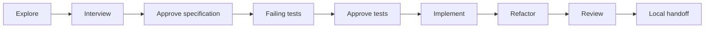

<div align="center">

# λ Lambda Harness

### Build with agents. Keep the decisions yours.

A local workspace for functional programming teams, from conversation to reviewed patches.

[Get started](#open-your-workspace) · [User guide](docs/GUIDE.md) · [Model backends](BACKENDS.md) · [Contribute](docs/DEVELOPMENT.md)

</div>

---

Good software starts with a clear conversation. Lambda Harness helps you explore
an idea, sharpen the requirements, and work through the change with specialist
agents—all from a local website.

**You approve the specification. You approve the tests. You choose what happens next.**

## A workflow that respects your craft

- **Think before coding.** Explore the repository and compare approaches, or let an
  interviewer challenge your assumptions until the requirements are clear.
- **Tests lead the way.** Review failing Cabal tests before implementation begins.
  Strict builds, lint, and Nix checks accompany code changes.
- **Build your team.** Browse agents with their own avatars, shape new specialists
  through chat, and share their definitions in Git.
- **Get a second opinion.** Review code, security, or documentation with dedicated
  specialists. An optional walkthrough helps you retain context.
- **Keep project knowledge close.** Save notes straight from chat, edit shared memory,
  preview what agents receive, and revisit earlier versions.
- **Own every patch.** Work stays in isolated local worktrees, with saved conversations
  and small commits. Prepare a handoff when you're ready to publish.
- **Pass the work on.** Export a handoff with the conversation, code, and project
  memory. A teammate imports it and continues from the saved step.
- **Pick up from your phone.** Connect privately through Tailscale to ask questions,
  review results, and approve the next step. [Set up phone access](docs/GUIDE.md#work-from-your-phone).

Start where you need help: have a chat, explore an idea, write tests, review a PR,
or take a feature through the full workflow. Every phase is a choice.

The task status reports whether a step completed, needs your input, or stopped with
an error. In **How to continue**, choose **One step at a time** or **All remaining
steps automatically**, then choose an action to start. Automatic mode still waits
for approvals and stops at the first error. After a failed check, choose **Ask agent
to fix the failure**, rerun checks, or send different instructions. Existing tasks
can continue this way without restarting.

Tasks can run at the same time in separate worktrees. Each task keeps its own model
choice, conversation, draft, progress log, result, and stop control. Switching tasks
does not move an active request, and a background task finishing does not switch your
view. One operation runs per task; project-wide settings and handoff transfers wait
until running tasks finish. Project memory remains shared intentionally.

Errors support conversation too: use **Ask a question** to ask what failed, request
commands you can run yourself, or describe an alternative. The agent can retry a
supported operation with your instructions; suggested commands are displayed, not
executed automatically. A failed commit also offers **Continue without commits**
(or ask for that in chat). This keeps subsequent changes uncommitted for this task
while validation and reviews continue. Existing commits and Git settings are preserved.
Signing errors include a terminal unlock suggestion based on the
[GnuPG guidance](https://www.gnupg.org/documentation/manuals/gnupg/Common-Problems.html).

Use **Run all checks and tests** on a completed task step to invoke the **Test runner**
agent in that task's worktree, including its uncommitted changes. It reads repository
instructions, task recipes, CI, and test manifests, then presents an ordered command
plan with suite coverage and omissions. Review the plan and choose **Run all checks
and tests** to execute it. Formatters such as `nix fmt` and `just lint` run first and
their changes stay in the worktree. The runner collects results for every planned
command, even when an earlier check fails, and supports stopping and rerunning.
It does not create commits. Use **Return to coding task** afterward; changed content
requires accepting the diff and revalidating before coding or review continues.

For a separate check task, choose **Run checks and tests** under New task and select
a base revision. Customize the **Test runner** definition and assignment on Agents.



## Open your workspace

With Nix, run this from any directory:

```sh
nix run --refresh github:Devnull-org/lambda-harness -- \
  --state-dir ~/.local/state/lambda-harness
```

`--state-dir` is required: it chooses where your conversations, memory, and worktrees
live. Reuse the same directory each time; existing users should keep their current path.

Open the printed local URL and add a Git checkout from **Projects**.
Switch between projects from the sidebar; each keeps its own memory and saved work.
Keep the server running while using the website.

Choose **General chat**, **Explore**, **Plan a feature or fix**,
**Review a PR or branch**, or **Write tests**.
Describe what you need. The harness checks your existing model logins and lets you
choose when more than one backend is available.

**Light, dark, or your system theme.** A familiar editor, visible conversation
history, and a stop button when you want to change direction.

Prefer running without Nix? See the [user guide](docs/GUIDE.md#without-nix).

## Your project. Your tools.

Powered by LangGraph and independent of any one model provider. The coding workflow
currently supports Haskell and Nix; more functional languages are planned.
Use existing agent logins or connect your own backend. Save architecture
notes and invariants as shared project context for the team’s workflow.

The website runs locally. Model requests use your chosen provider. The harness
creates no pull requests and pushes no code automatically.

[Explore the workflow →](docs/GUIDE.md) · [Configure project checks →](docs/VALIDATION.md)

Use the single message box in a task's **Conversation** section to talk to the
agent handling that step. Exploration follow-ups go to the explorer; patch
requests go through the current coding agent and its existing approval flow.
Between steps, you can still ask the current agent for explanations or a commit
message without starting the next phase. Workflow buttons remain in **Task actions**.

Select the model above the message box. Your choice is remembered across page
reloads and saved per task when a request starts. Explicit choices override role
and provider defaults. Replies show the requested model and, when the provider
reports it, the actual model ID. An unavailable selection fails visibly instead
of silently switching to another model.
Use **Effort** beside the model picker to choose a level advertised by that model.
The selection is saved per task and model; **Provider default** clears the override.
Higher effort can take longer. Review receipts show each reviewer's requested and reported model and selected effort.
